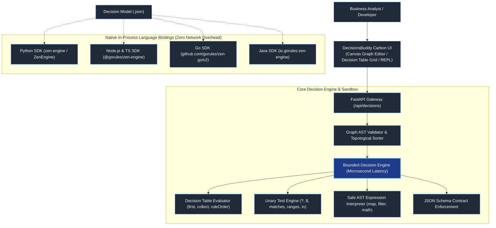

# DecisionsBuddy Engine & Language Bindings Documentation

DecisionsBuddy is a high-performance, bounded declarative Business Rules Engine (BRE) implementing the universal Decision Model standard with multi-language native in-process bindings and enterprise governance.

---

## 1. Architectural Overview



---

## 2. Decision Graph & Node Types

A decision model is represented as a Directed Acyclic Graph (DAG) consisting of `nodes` and `edges`:

### Node Types

1. **`inputNode`**:
   - Starting node of the decision graph.
   - Accepts input payloads and validates incoming data contracts using standard JSON Schema.
   - Rejects non-conforming requests with descriptive validation errors before rule execution.

2. **`decisionTableNode`**:
   - Tabular decision logic with configurable inputs, outputs, and rules.
   - Evaluates row-level conditions and projects matching results.
   - Supports hit policies: `first`, `collect`, and `ruleOrder`.

3. **`expressionNode`**:
   - Executes declarative variable transformations and formulas without custom code.
   - Computes calculated fields using safe AST interpretation and collection functions.

4. **`switchNode`**:
   - Conditional branch router evaluating statements against input context.
   - Routes graph execution exclusively through active outgoing handles (`sourceHandle`).

5. **`watsonxAiNode` & `watsonxMlNode`**:
   - Connects declarative rules to enterprise foundation models and machine learning pipelines.
   - Maps context variables into model prompts and scoring endpoints.

6. **`decisionNode`**:
   - Sub-decision node enabling modular composition of sub-rulesets by key.

7. **`outputNode`**:
   - Final node collecting context outputs or projecting fields via JSON Schema schema contracts.

---

## 3. Decision Table Hit Policies

| Hit Policy | Description | Return Format |
| :--- | :--- | :--- |
| **`first`** | Evaluates rows top-to-bottom. Stops at the first matching rule and returns its outputs. | `Map<String, Any>` (single object) |
| **`collect`** | Evaluates all rows. Returns outputs of every matching rule in order. | `List<Map<String, Any>>` (array) |
| **`ruleOrder`** | Evaluates all rows. Ensures matching rule outputs maintain strictly defined declaration sequence. | `List<Map<String, Any>>` (array) |

---

## 4. Unary Test Grammar & Condition Expressions

Cell conditions in Decision Table input columns support flexible declarative unary tests:

### A. Dynamic Placeholders (`?` and `$`)
Allows referencing the input cell value dynamically in expressions:
- `endsWith(?, '@gorules.io')` -> Matches any email ending with `@gorules.io`.
- `matches(?, '^[A-Z]{3}-\\d{3}$')` -> Validates format (e.g. `ABC-123`).
- `? >= 10 and ? <= 50` -> Compound boundary check.
- `$ > 100` -> Dollar placeholder alias for current cell value.

### B. Regular Expression Matching
- `matches(?, 'pattern')`: Evaluates standard regex expressions against string inputs.

### C. Negation
- `not(in ['FRAUD', 'BLOCKED'])`: Inverts condition logic cleanly.
- `not(startsWith('TEST-'))`: Excludes matching prefixes.

### D. Multi-Value List Shorthand
- `10, 20, 30`: Matches if the cell equals any listed value.
- `'US', 'CA', 'MX'`: Matches country codes.

### E. Range Intervals
- `[18..65]`: Closed range (18 <= x <= 65).
- `(0..100)`: Open range (0 < x < 100).
- `[0..100)`: Half-open range.

### F. Standard Comparisons & Null Checks
- `>=`, `<=`, `>`, `<`, `!=`, `==`, `=`
- `is null`, `is not null`, `true`, `false`, `contains "item"`

---

## 5. Built-in Higher-Order & Mathematical Functions

Available in Expression nodes, dynamic table outputs, and unary tests:

- **Collection Transformations**:
  - `map(array, 'property')`: Extracts property values from objects.
  - `filter(array, 'key', 'expectedValue')`: Filters matching elements.
  - `find(array, 'key', 'expectedValue')`: Retrieves first matching element.
  - `flatten(nestedArray)`: Flattens multi-dimensional arrays.
  - `unique(array)`: Removes duplicate values.
  - `join(array, delimiter)`: Joins array elements into a string.
  - `slice(array, start, end)`: Extracts array slice.
- **String Utilities**:
  - `startsWith(str, prefix)` / `endsWith(str, suffix)`
  - `split(str, delimiter)`
  - `replace(str, search, replacement)`
- **Aggregation & Math**:
  - `sum(list)`, `avg(list)`, `min(...)`, `max(...)`, `count(list)`
  - `round(num, decimals)`, `floor(num)`, `ceil(num)`, `abs(num)`
  - `diffDays(date1, date2)`

---

## 6. Language Bindings Quick Reference

All 4 language bindings execute decision models **in-process** with zero HTTP overhead and microsecond latency.

### 1. Python Binding (`zen-engine`)
```python
from zen_engine import ZenEngine

engine = ZenEngine(options={"loader": my_loader})
decision = engine.create_decision(decision_json_bytes_or_dict)
response = decision.evaluate({"cart": {"total": 150}}, options={"trace": True})

print(response["result"])
print(response["performance"])  # e.g., "14.2µs"
```

### 2. Node.js & TypeScript Binding (`@gorules/zen-engine`)
```typescript
import { ZenEngine } from '@gorules/zen-engine';
import fs from 'fs';

const engine = new ZenEngine();
const content = fs.readFileSync('decision.json', 'utf-8');
const decision = engine.createDecision(content);

const response = await decision.evaluate({ cart: { total: 150 } }, { trace: true });
console.log(response.result);
console.log(response.performance);
```

### 3. Go Binding (`github.com/gorules/zen-go/v2`)
```go
package main

import (
    "context"
    "fmt"
    "github.com/gorules/zen-go/v2"
)

func main() {
    ctx := context.Background()
    engine := zen.NewEngine()
    decision, _ := engine.CreateDecision(decisionBytes)

    res, _ := decision.EvaluateWithOpts(ctx, map[string]any{"cart": map[string]any{"total": 150}}, zen.EvaluationOptions{Trace: true})
    fmt.Println(res.Result, res.Performance)
}
```

### 4. Java Binding (`io.gorules:zen-engine`)
```java
import io.gorules.zen_engine.JsonBuffer;
import io.gorules.zen_engine.ZenDecision;
import io.gorules.zen_engine.ZenEngine;
import io.gorules.zen_engine.ZenResponse;

try (ZenEngine engine = new ZenEngine()) {
    ZenDecision decision = engine.createDecision(new JsonBuffer(decisionJsonString));
    ZenResponse response = decision.evaluateSync(new JsonBuffer("{\"cart\": {\"total\": 150}}"), null);
    System.out.println(response.result());
    System.out.println(response.performance());
}
```

---

## 7. Security & Sandbox Boundary

1. **Zero-Trust AST Evaluation**:
   - The expression interpreter uses a bounded Python/JavaScript/Go/Java AST visitor.
   - Dynamic code execution (`eval`, `Function`, `exec`, Python introspection `__class__`, `os`, `subprocess`) is strictly blocked.
2. **Resource Boundaries**:
   - Graph cycle detection prevents infinite loops.
   - Node evaluation budgets prevent denial-of-service allocations.
3. **Executable Function Node Denial**:
   - Executable JavaScript/Python scripts inside `functionNode` are disallowed in multi-tenant environments.
   - Higher-order functions (`map`, `filter`, `find`) provide full expressive power safely and declaratively.
